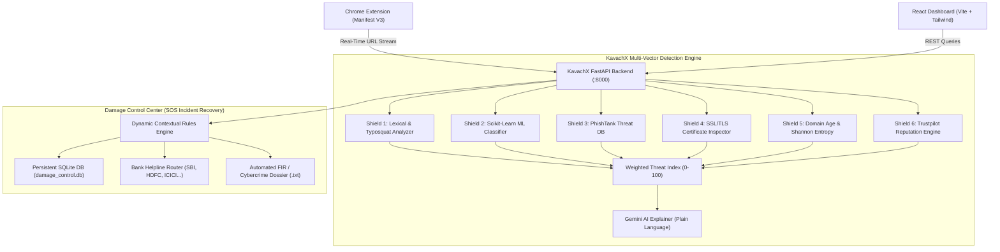

# 🛡️ KavachX — Smart Security • Strong Protection

[](LICENSE)
[](https://fastapi.tiangolo.com)
[](https://react.dev)
[](https://www.python.org)
[](https://developer.chrome.com/docs/extensions/mv3/intro/)
[](#)

> **KavachX** is an AI-powered, multi-channel anti-fraud and cyber-recovery intelligence platform. It provides **real-time proactive zero-day phishing detection** across Web links, SMS, and WhatsApp messages, paired with an emergency post-breach **Damage Control Center (SOS Mode)** that executes the **Golden Hour Protocol** and auto-generates legal Cybercrime FIR dossiers.

---

<p align="center">
  
  <br>
  <strong>KAVACHX — SMART SECURITY • STRONG PROTECTION</strong>
</p>

---

## 📑 Table of Contents

- [The Critical Problem](#-the-critical-problem)
- [Why KavachX? (Key Differentiators)](#-why-kavachx-key-differentiators)
- [System Architecture](#-system-architecture)
- [Core Features](#-core-features)
  - [1. Web Guard (6-Shield Scanner)](#1-web-guard-6-shield-scanner)
  - [2. SMS Guard (Smishing & WhatsApp Scam Detector)](#2-sms-guard-smishing--whatsapp-scam-detector)
  - [3. Trust Report (Trustpilot Consumer Intelligence)](#3-trust-report-trustpilot-consumer-intelligence)
  - [4. Damage Control Center (SOS Incident Recovery)](#4-damage-control-center-sos-incident-recovery)
  - [5. System Analytics & Telemetry](#5-system-analytics--telemetry)
  - [6. High-Impact Cyber Hero Splash Screen](#6-high-impact-cyber-hero-splash-screen)
- [Tech Stack](#-tech-stack)
- [Quick Start Guide](#-quick-start-guide)
  - [Prerequisites](#prerequisites)
  - [One-Click Startup (Windows)](#one-click-startup-windows)
  - [Manual Step-by-Step Setup](#manual-step-by-step-setup)
  - [Chrome Extension Setup](#chrome-extension-setup)
- [API Documentation & Endpoints](#-api-documentation--endpoints)
- [Damage Control Center Workflow](#-damage-control-center-workflow)
- [Security & Privacy Principles](#-security--privacy-principles)
- [License](#-license)

---

## 🚨 The Critical Problem

Over **₹1,750+ Crores** are lost to digital financial fraud every year. Despite existing browser warnings and antivirus tools, phishing attacks succeed every **39 seconds**. Why?

1. **Static Blocklist Lag**: Traditional security tools depend on centralized blocklists (e.g. Google Safe Browsing). When scammers launch a new domain, it takes 24 to 48 hours to get reported. By then, thousands have already been defrauded.
2. **Multi-Channel Social Engineering**: Modern cyber scams don't originate in web searches—they arrive via SMS and WhatsApp claiming *"Electricity power will be cut tonight at 9:30 PM"* or *"Your SBI NetBanking is blocked due to KYC"*.
3. **The Post-Breach Vacuum**: Existing security tools completely abandon the victim once a link is clicked, an OTP is read, or payment is sent. Victims panic, delay reporting, and miss the critical **2-hour window** where inter-bank fund recovery is possible.

---

## ✨ Why KavachX? (Key Differentiators)

| Feature | Standard Anti-Phishing Tools | KavachX |
| :--- | :--- | :--- |
| **Detection Approach** | Reactive static blocklists | **Proactive 6-Shield Heuristics + ML (< 1.2s)** |
| **Attack Surfaces** | Web browser URLs only | **Web URLs + SMS / WhatsApp Messaging Payloads** |
| **Zero-Day Detection** | ❌ Fails on fresh unlisted domains | ✅ **Detects via lexical entropy & Trustpilot review gaps** |
| **Post-Breach Support** | ❌ None (Tool closes after warning) | ✅ **Damage Control Center (Interactive Triage)** |
| **Financial Recovery** | ❌ None | ✅ **Golden Hour Protocol + Dynamic Bank Fraud Desks** |
| **Legal Documentation** | ❌ None | ✅ **Instant Automated Cybercrime FIR Dossier (.txt)** |
| **Explainability** | Cryptic error codes | ✅ **Gemini AI Plain-Language Summaries (Zero Jargon)** |

---

## 🏛️ System Architecture



---

## 🌟 Core Features

### 1. Web Guard (6-Shield Scanner)
Inspects any website in **< 1.2 seconds** through six concurrent analytical layers:
- **Shield 1: Lexical & Typosquat Analysis**: Detects brand spoofing, character homoglyphs (e.g., `paypa1.com` using digit `1`), confusing subdomains, and credential-harvesting tokens.
- **Shield 2: Machine Learning Classifier**: A trained `scikit-learn` ensemble model evaluating 16+ structural features (path depth, digit-to-letter ratio, delimiter frequency).
- **Shield 3: Threat Intelligence (PhishTank)**: Real-time queries against validated threat feeds.
- **Shield 4: SSL/TLS Certificate Validator**: Inspects certificate issuer, validity period, and prevents the "green lock fallacy" (scammers with free 90-day certificates).
- **Shield 5: Domain Age & Shannon Entropy**: Identifies high-randomness domains (`x7k9q2m1p0z.top`) and newly registered infrastructure.
- **Shield 6: Zero-Day Heuristics**: Detects unlisted phishing kits using behavioral signals.
- **Live Chrome Extension Sync**: Background service worker automatically streams visited tabs to the dashboard live without manual page reloads.

### 2. SMS Guard (Smishing & WhatsApp Scam Detector)
- Analyzes incoming messages for **psychological manipulation patterns** (false countdowns, electricity disconnection threats, fake part-time job lures).
- Audits official sender IDs (`VK-POWR`, `VK-SBIINB`, `AD-INDPOST`) for authority impersonation.
- **Deep Link Extraction**: Extracts embedded URLs and automatically runs them through the 6-shield Web Guard engine.

### 3. Trust Report (Trustpilot Consumer Intelligence)
- Scammers rely on fresh, unreviewed domains to bypass security filters.
- KavachX queries verified consumer review data. When a supposed payment site has **0 reviews / Unverified status**, it is flagged as a **Zero-Day Imposter**.

### 4. Damage Control Center (SOS Incident Recovery)
The platform's standout innovation that transforms post-scam panic into structured, effective recovery:
- **Dynamic Multi-Step Intake Wizard**: Customizes recovery steps based on:
  - *I clicked a suspicious link*
  - *I shared my password or OTP*
  - *I sent money to a scammer*
  - *I shared personal information (Aadhaar / PAN)*
  - *I installed an app or gave remote access (AnyDesk / APK)*
- **The "Golden Hour" Protocol (< 2 Hours)**: Automatically triggers an emergency alert if financial loss happened within 2 hours. Prominently surfaces the **1930 National Cyber Crime Hotline** and initiates an inter-bank settlement recall.
- **Direct Bank Helpline Routing**: Injects 24/7 emergency fraud desk numbers based on the user's selected bank (*SBI: 1800-11-2211, HDFC: 1800-202-6161, ICICI: 1800-1080, PhonePe, Paytm, etc.*).
- **Automated FIR & Cybercrime Dossier Generator**: One-click download of a pre-formatted legal complaint draft (`.txt`) containing the victim's statement, UTR number, scammer contact, incident timestamp, and evidence logs formatted for `cybercrime.gov.in`.

### 5. System Analytics & Telemetry
- Real-time diagnostic monitoring of all 8 detection subsystems.
- Threat classification breakdown (Safe vs. Suspicious vs. Dangerous).
- Detection trigger counts and engine response latency metrics.

### 6. High-Impact Cyber Hero Splash Screen
- 3-second animated startup screen featuring the official KavachX shield logo.
- Animated security engine initialization progress bar (`0% → 100%`).
- Smooth transition revealing the clean light-theme dashboard.

---

## 💻 Tech Stack

- **Frontend**: React 18, Vite, TypeScript, Tailwind CSS, Lucide Icons, Recharts.
- **Backend**: Python 3.12, FastAPI, Uvicorn (Asynchronous REST API).
- **Machine Learning**: `scikit-learn`, `joblib` (RandomForest & DecisionTree classifiers).
- **Generative AI (XAI)**: Google Gemini API via `google-generativeai`.
- **Browser Extension**: Chrome Manifest V3 background service worker.
- **Database**: SQLite3 (`damage_control.db`, `feedback.db`).

---

## 🚀 Quick Start Guide

### Prerequisites
- **Node.js** (v18 or higher) and `npm`
- **Python** (v3.11 or v3.12)
- **Google Chrome** (for loading the extension)

---

### One-Click Startup (Windows)
Double-click `start_all.bat` in the repository root, or run in PowerShell:
```powershell
.\start_all.bat
```
This automatically boots both the FastAPI backend on `http://127.0.0.1:8000` and the Vite dashboard on `http://localhost:5173`.

---

### Manual Step-by-Step Setup

#### 1. Backend Setup
```powershell
cd backend

# Activate virtual environment
.\venv\Scripts\activate

# Install dependencies (if not already installed)
pip install -r requirements-dev.txt

# Start FastAPI server
python -m uvicorn app.main:app --host 127.0.0.1 --port 8000 --reload
```
*Backend runs at `http://127.0.0.1:8000` (API Docs at `http://127.0.0.1:8000/docs`).*

#### 2. Frontend Dashboard Setup
```powershell
cd dashboard

# Install packages
npm install

# Start Vite dev server
npm run dev
```
*Dashboard opens at `http://localhost:5173`.*

---

### Chrome Extension Setup
1. Open Google Chrome and go to `chrome://extensions/`.
2. Toggle on **Developer mode** in the top-right corner.
3. Click **Load unpacked** and select the folder:
   `c:\Users\hp\SGU_HackX\PhishLens\extension\dist`
4. Browse any website in Chrome—the telemetry will stream live to your KavachX Dashboard!

---

## 📡 API Documentation & Endpoints

| Method | Endpoint | Description |
| :--- | :--- | :--- |
| `POST` | `/analyze` | Run 6-shield inspection on a target URL with DOM signals |
| `POST` | `/analyze/smishing` | Forensically analyze an SMS/WhatsApp text payload |
| `GET` | `/reputation/trustpilot` | Retrieve Trustpilot star distribution & fraud indicators |
| `POST` | `/explain` | Generate plain-language Gemini AI threat explanations |
| `GET` | `/recent-scans` | List recent scans captured by the extension or dashboard |
| `GET` | `/recent-scans/latest` | Poll the most recent scan for live extension synchronization |
| `GET` | `/diagnostics` | System health check and capability telemetry |
| `GET` | `/stats` | Aggregate report counts and false positive analytics |
| `POST` | `/api/damage-control/incidents` | Create a new incident and generate tailored recovery plan |
| `GET` | `/api/damage-control/incidents/{id}` | Retrieve incident state and checklist progress |
| `PATCH`| `/api/damage-control/incidents/{id}/actions/{action_id}` | Toggle an action checklist step as completed |
| `POST` | `/api/damage-control/incidents/{id}/close` | Mark incident as resolved and archive |
| `GET` | `/api/damage-control/incidents/{id}/dossier` | Download formal Cybercrime FIR complaint docket (`.txt`) |

---

## 🔄 Damage Control Center Workflow

```text
User selects incident scenario
           │
           ▼
Targeted questionnaire collects details (Bank name, UTR, time elapsed, data shared)
           │
           ▼
Rules engine calculates severity (CRITICAL / HIGH / MODERATE)
           │
           ├──► [If Elapsed < 2h] Activate "Golden Hour Protocol" (Flash alert + Dial 1930)
           │
           ├──► Injects specific 24/7 bank fraud helpline numbers (SBI, HDFC, ICICI...)
           │
           ├──► Generates prioritized step-by-step interactive checklist (Saved to SQLite)
           │
           └──► Auto-compiles formal Cybercrime FIR Complaint Dossier (.txt download)
```

---

## 🔒 Security & Privacy Principles

- **Zero Plain-Text Credential Storage**: KavachX never requests or stores actual passwords or OTPs. Only categorical metadata (e.g. *"password shared: yes"*) is processed.
- **Privacy-Preserving Telemetry**: The Chrome extension evaluates domains and URLs without exfiltrating private cookies, form inputs, or browsing history.
- **Local Fallback Execution**: The ML classifier and heuristic shields run entirely offline on local hardware, ensuring uninterrupted security even without internet access.

---

## 📄 License

This project is licensed under the [MIT License](LICENSE).

---

<p align="center">
  <strong>Built with dedication for SGU HackX 2026</strong>
  <br>
  <em>KavachX Security Labs — Smart Security • Strong Protection</em>
</p>
